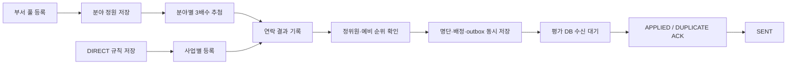

# Lex6won v2 기능 모듈 인계서

2026-10-16 / 브랜치 `feat/lex6won-committee-v2` / main `beeb32a` 기반.
기준은 `docs/planning/2026-10-16/AUTOPILOT_DEVELOPMENT_HANDOFF_V2.md`, `SCHEMA_ACTION_MODEL_V2.json`이다. v1 명세 대신 v2의 `roster.confirmed`, PENDING/SENT/FAILED를 적용한다.

## 1. 담당 범위

| 담당 | 제공/연결 |
|---|---|
| 원준석 | COM/DRAW/ROS 16개 버튼 함수, 분야 조회, SQLite migration, 합성 테스트, outbox, 기존 후보 이전 |
| 현수환 | 버튼/API 연결, 로딩·오류·충돌 표시, 미리보기 행 오류 표시 |
| 김유진 | 공통 인증 Context, 공통 부모 테이블/데이터, 평가 DB 수신기, 참석·위원장·평가 |
| 오대웅 | 기존 문서 파서/DB 유지, 사업 ID·통합 계약 공동 검토 |

공통 담당 배분은 기존 v2의 제안 기준이다. 다른 팀원의 코드와 실제 DB는 이번에 수정하지 않았다. 기존 v1 웹과 새 기능 모듈을 구분한다.

## 2. 호출 규약

모듈 폴더를 Python import 경로로 사용한다. 인증을 완료한 공통 API에서 아래처럼 호출한다.

```python
from pathlib import Path
from committee_app.v2_core import Context, Runtime, ModuleError
from committee_app.v2_gateway import dispatch_action, error_response

runtime = Runtime(Path("data/admin.sqlite3"),
    pii_key=pii_key_from_secret_store,
    lookup_key=lookup_key_from_secret_store,
    auth_key=shared_auth_key_from_secret_store,
    auth_key_version=1)
await runtime.initialize()  # 공통 부모 스키마 선행
ctx = Context(actor_id=authenticated_admin_id, request_key=idempotency_header)
try:
    result = await dispatch_action(ctx, "COM-05", {
        "department_id": department_id, "scope": "DEPARTMENT_POOL",
        "name": "가상위원", "organization_name": "가상소속",
        "phone": "01000000001", "specialty_ids": [specialty_id],
    }, runtime=runtime)
except ModuleError as exc:
    result = error_response(ctx, exc)  # HTTP 상태는 exc.status
```

dispatch_action은 내부 호출기이며 HTTP 서버가 아니다. URL/세션/CSRF/업로드 스트리밍 크기 제한은 공통 API에서 구현한다. 클라이언트 JSON의 actor_id를 Context로 신뢰하면 안 된다. 현재 DB의 관리자 역할·부서·활성 상태를 다시 확인한다.

직접 함수는 data DTO, dispatcher는 `{data,meta:{request_id,version?,sync_status?}}`를 반환한다. 파일은 `ExportFile(filename,content,media_type)`로 반환하므로 다운로드 응답으로 전환한다. 오류는 `{error:{code,message,retryable},meta:{request_id}}`다.

모든 쓰기에 request_key가 필요하다. 같은 작업 재시도는 같은 키, 새 내용은 새 키다. 동일 키/다른 본문은409. 저장 시 조회한 version을 보내고 VERSION_CONFLICT면 재조회한다. 저장 성공은 SQLite 커밋 후 반환된다. 중복 요청 응답도 현재 권한을 확인한 후 반환한다.

## 3. 버튼 입력·출력

정확한 길이·enum·선택값은 `committee_app/v2_contracts.py`, `contracts/module_inputs_v2.json` 참조. 공통 사업/부서/분야 ID를 그대로 전달한다.

| 버튼 | 파일.함수 | 입력 핵심 | 출력 |
|---|---|---|---|
| COM-01 | candidate_pool.search_candidates | department_id,scope,project_id?,search?,specialty_id?,active?,page/page_size | items,total,page,page_size |
| COM-02 | candidate_import.download_template | 빈 dict | XLSX 서식 |
| COM-03 | candidate_import.preview_import | department_id,scope,project_id?,filename + raw/password 별도 | id,version,valid_count,errors,can_commit,expires_at,마스킹 items |
| COM-04 | candidate_import.commit_import | preview_id,version | count,candidate_ids,status,version |
| COM-05 | candidate_pool.create_candidate | department_id,scope,project_id?,name,organization_name,phone,specialty_ids + 선택 email/position/department_name | 후보 상세,version |
| COM-06 | candidate_pool.update_candidate | candidate_id,version + 전체 후보 속성 | 수정 상세,새 version |
| COM-07 | candidate_pool.deactivate_candidate | candidate_id,version | active=false,새 version |
| COM-CATALOG | candidate_pool.list_specialties | 빈 dict | 활성 분야 id/code/name |
| DRAW-01 | committee_selection.save_rules | project_id,selection_mode,target_count,reserve_count,quotas,version(최초0) | 규칙 id,version,quotas |
| DRAW-02 | committee_selection.draw_shortlist | project_id,rule_version | draw id,members,nominee_id,pool_sha256 |
| DRAW-03 | committee_selection.export_shortlist | project_id,draw_id | 추첨명단 XLSX |
| ROS-01 | committee_roster.list_nominees | project_id,contact_status?,specialty_id? | items(후보 포함),total,rule,roster |
| ROS-02 | committee_roster.add_nominee | project_id,candidate_id | 사업 후보 id,version |
| ROS-03 | committee_roster.save_contact | project_id,nominee_id,version,contact_status,contact_note? | 연락 결과,새 version |
| ROS-04 | committee_roster.exclude_nominee | project_id,nominee_id,version,reason | 제외 결과,새 version |
| ROS-05 | committee_roster.confirm_roster | project_id,rule_version,members[{nominee_id,version,member_kind,reserve_order?}] | roster id,배정,hash,event_id,sync_status=PENDING |
| ROS-06 | committee_roster.export_roster | project_id,roster_id | 확정 명단 XLSX |

신규 사업 후보는 COM-05/엑셀에 scope=PROJECT와 project_id를 넣는다. 기존 부서 후보 추가는 ROS-02다. DIRECT 규칙을 먼저 저장해야 한다. 사업 후보는 부서 풀에 자동 포함되지 않는다.

COM-06은 전체 후보 폼 저장이다. 관련 사업의 연락 상태를 NOT_CONTACTED로 초기화하고 version을 올린다. COM-07은 논리 삭제다. 삭제 이력에도 부서별 전화번호 고유성을 유지하여 같은 번호 재등록은 충돌 처리한다. 자동 복구/풀 승격 기능은 없다.

## 4. 업무 흐름·오류



- POOL_RANDOM: quota 합계 7~9명, 분야별 quota×3 확보, 사람 중복 없음. 후보별 여러 분야가 겹쳐 전체 매칭이 불가능해도 POOL_SHORTAGE다. 무작위 순서로 증대 경로 매칭하며 균등 분포를 보장한다고 주장하지 않는다.
- DIRECT: 추첨 없이 등록한다. target_count 7~9명, reserve_count 설정값을 따른다.
- 연락 상태는 NOT_CONTACTED/AVAILABLE/UNAVAILABLE/CALLBACK. 제외된 후보는 연락 변경/확정에서 거절한다.
- PRIMARY=target_count, RESERVE=reserve_count, 예비 순위는 1부터 연속이다. 풀 정위원은 추첨 배정 분야별 quota를 충족해야 한다.
- 확정 뒤 연락/후보/명단 수정·재추첨은 거절한다. 실제 참석·예비 승격·위원장 선정은 평가 담당 기능이다. 별도 revision 정책 없이 동결 증빙을 바꾸지 않는다.
- VERSION_CONFLICT는 재조회, POOL_SHORTAGE는 풀 보강, LOGIN_COLLISION은 이름+뒤4자리 식별 정책 확인으로 처리한다.
- IMPORT_ERRORS/FILE_INVALID는 엑셀 수정 후 새 미리보기다. 30분 만료, XLSX 8MB/5,000행, 암호 파일 지원, 수식·매크로·DTD/ENTITY 거절. 오류가 하나라도 있으면 전체 등록을 막는다.
- AUTH_REQUIRED/FORBIDDEN은 로그인/권한 확인, DB_UNAVAILABLE은 같은 요청키 재시도다. ROSTER_LOCKED/DRAW_LOCKED/PROJECT_LOCKED는 변경 절차가 필요한 상태로 표시한다.

## 5. SQLite·FK·이전

| 소유 | 테이블 |
|---|---|
| 공통 부모 | departments,admin_users,admin_permissions,projects |
| 등록 | evaluator_candidates,specialties,candidate_specialties,candidate_imports |
| 선정 | committee_rules,field_quotas,committee_draws,draw_members |
| 연락·배정 | project_nominees,committee_rosters,committee_assignments |
| 공통 인프라 | audit_events,idempotency_records,sync_outbox,sync_inbox,schema_migrations |

`migrations/20261016_lex_001.sql`은 위원 테이블과 공통 인프라를 생성한다. 공통 부모는 선행해야 한다. fixtures/shared_parents.sql은 개발용이다. 실제 테이블/필드/FK 계약은 contracts/committee_schema_v2.json이다.

연결마다 foreign_keys=ON, 쓰기는 BEGIN IMMEDIATE다. FK는 RESTRICT, 복합 FK는 다른 사업의 draw/nominee/roster 연결을 막는다. 추첨·명단·배정은 UPDATE/DELETE 차단 trigger로 동결한다. migration 파일 checksum을 기록하므로 적용 후 수정은 거절한다.

기존 DB를 v2 Runtime에 지정하면 LEGACY_SCHEMA로 중단한다. 새 DB를 만들고 `v2_legacy.migrate_legacy_pool(ctx,source=Path(...),department_id=...,specialty_map={기존분야:새ID},runtime=...)`로 PREVIEW를 받는다. 확인한 source_sha256을 expected_sha256으로 다시 전달하면 활성·완전 후보를 원본 ID로 이전한다. 오류·충돌·원본 변경은 전체 중단이다. 원본은 읽기 전용이고 기존 사업/추첨/명단/로그인은 자동 이전하지 않는다.

실제 DB에 이번 migration/이전은 실행하지 않았다. 문서·평가 DB를 직접 수정하지 않는다. Git 공유는 소스/DDL/계약/합성 자료이며 SQLite 바이너리를 merge하지 않는다.

## 6. 평가 모듈 전달

`v2_handoff.pending_events`의 envelope를 인증된 내부 수신기에 전달한다. 합성 실출력 예시는 contracts/roster_confirmed_v2.fixture.json이다.

| 필드 | 규약 |
|---|---|
| contract_name/schema_version | roster.confirmed / 2 |
| source/destination | admin / evaluation |
| event_id | 최초 UUID, 재시도 때 유지 |
| aggregate_id/version | roster_id / 1 (현재 첫 확정만 지원) |
| project_id | 공통 원본 사업 ID |
| payload | roster_id,project_id,revision_no,status,confirmed_at,roster_sha256,assignments 전체 |
| assignments | id,project_id,roster_id,member_kind,reserve_order,name_snapshot,organization_snapshot,login_lookup_hmac,status,auth_key_version |
| payload_sha256 | JSON 재귀 키정렬, ensure_ascii=False, separators=(',',':'), UTF-8 SHA256 |
| roster_sha256 | id 순서의 payload.assignments를 같은 규칙으로 해시 |

후보 원본 ID·부서 풀·전체 전화·이메일·비밀키는 payload에 없다. 화면 확정 응답에서도 login_lookup_hmac을 제외한다. 해시는 송신자 인증을 대신하지 않는다.

로그인 HMAC: 이름 NFC→모든 공백 제거→casefold, 정규화한 전화 마지막4자리. `[project_id,normalized_name,last4]`를 위 JSON 규칙으로 직렬화해 공유 AUTH_LOOKUP_KEY로 HMAC-SHA256 hex를 계산한다. 키와 auth_key_version이 같아야 한다. 키는 Git/envelope에 넣지 않는다. 인증·시도 제한·실제 참석 확인은 공통 인증/평가 담당 범위다.

수신기는 사업 부모·버전·해시를 검사하고 명단/배정 사본+inbox를 원자 반영한다. `{event_id,payload_sha256,aggregate_version,schema_version,status:APPLIED|DUPLICATE}` ACK를 `acknowledge_event`에 넘기면 outbox가 SENT가 된다. 해시/버전 불일치는 거절한다. 이 함수에 임의 HTTP 본문을 넣으면 안 된다. PENDING은 평가 DB 반영 완료를 뜻하지 않는다. 수신기/재시도 스케줄러의 실제 연결은 후속 통합 대상이다.

## 7. 검증·Git 상태

[검증 기록](../evidence/verification-v2.md) 참조. 새 기능은 합성 temp SQLite로 검사하며 기존 v1 회귀 테스트도 실행한다. 사용자 요청에 따라 개인 포크 브랜치와 원본 저장소 PR로 검토를 요청한다. gg verify 하네스 미초기화와 보안 점검 시간 초과는 통과로 기록하지 않는다. 운영 준비 완료를 뜻하지 않으며, 병합 결정은 저장소 관리자가 한다. 훅이나 CI를 우회하지 않는다.
