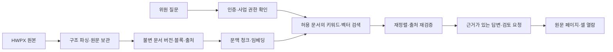

# 문서 처리 코드 검토와 RAG 활용 방안

검토일: 2026-10-11 · 담당: DaeUng79 · 범위: `apps/documents_daeung/`의 현재 소스와 테스트. 아래 개선안은 구현 전 제안이다. 외부 MongoDB·실문서·유료 모델에 접속하지 않았으며 처리시간·검색 품질은 아직 측정하지 않았다.

[개인 개발 안내](README.md) · [DB 선택안](DATABASE_REVIEW.md) · [실행할 추진계획](ACTION_PLAN.md) · [함수 안내](FUNCTION_GUIDE.md)

## 1. 현재 개발 수준

현재는 **구조와 출처를 보존하는 문서 처리 기반**이다. 이를 유지하면서 검색·업무 API를 추가하는 편이 적절하다. `make_chunks()`는 검색용 텍스트를 만들지만 `embedding_status="not_generated"`를 기록한다. 임베딩 생성, 벡터 검색, 검색 결과 기반 대화, 사업별 접근 권한, 위원회 운영 자동화는 추가 구현 대상이다.

| 파일 | 현재 역할 | 유지할 설계 |
| --- | --- | --- |
| [step1_parser_hwpx.py](../../apps/documents_daeung/step1_parser_hwpx.py) | HWPX XML·표·이미지·원문 위치 파싱, HWP 렌더 트리 처리 | 중첩 표·셀 관계, 블록 순서, 물리 페이지와 인쇄 쪽번호 구분 |
| [step2_hwpx_storage.py](../../apps/documents_daeung/step2_hwpx_storage.py) | 청크 생성, MongoDB/GridFS 저장 | 파일 해시 검증, 버전별 upsert, 저장 건수 확인 후 활성 버전 공개 |
| [step3_ai_requirements_SQLite.py](../../apps/documents_daeung/step3_ai_requirements_SQLite.py) | 모델로 원문 블록 ID를 선택하고 요구사항 복사 | 모델이 원문을 재작성하지 않고 참조만 선택, 저장 전후 버전 검사 |
| [step4_ai_criteria.py](../../apps/documents_daeung/step4_ai_criteria.py) | 요구사항을 평가기준 초안으로 변환 | 원문 기준표 우선, 항목·배점 유지, 서식과 요구사항 버전 연결 |
| [streamlit_main.py](../../apps/documents_daeung/streamlit_main.py) | 업로드·이력·문서·요구사항·기준 확인 | 실패 시 파싱 결과 보존, 재저장, 명시적인 추출 버튼 |
| [streamlit_main.py --page-preview](../../apps/documents_daeung/streamlit_main.py) | 별도 프로세스의 SVG 미리보기 | 원본 해시 확인, 렌더러 종료, 미리보기 캐시 |

형식 지원은 구분해야 한다. HWPX가 주 대상이며 현재 업로드 위젯도 HWPX만 허용한다. HWP CLI 경로는 존재하지만 병합·음영·이미지 바이너리 처리에 제한이 있고, `parse_hwp()` 결과의 공통 ID·스키마 필드는 CLI에서 보충한다. HWPX/HWP 두 함수의 반환 계약이 완전히 같지는 않다.

## 2. 먼저 해결할 정확성·실행 문제

| 순서 | 소스에서 확인한 근거 | 영향과 권장 수정 | 완료 검증 |
| --- | --- | --- | --- |
| P0-1 | 앱과 테스트의 `apps.app.documents` import, 모듈 폴더 기준 `.env`·가상환경 탐색 | 현재 폴더에서는 5개 테스트 모듈이 import 실패. 패키지 실행 경로와 설정 경로를 하나로 정하고 CLI·작업자·AppTest를 함께 수정 | import 오류 0건, 네트워크 차단 회귀 테스트, 새 환경 실행 |
| P0-2 | `prepare_records()`가 `local_path`·`image_path` 등까지 포함한 전체 JSON을 revision 해시로 사용 | 같은 본문도 PC·출력 폴더 변경으로 다른 버전이 될 수 있음. 원문 해시·파서 버전·스키마·정규화한 추출 내용·페이지 정책으로 의미 버전을 계산하고 저장 경로는 분리 | 합성 입력에서 경로만 바꾸면 동일 revision, 내용·파서 정책 변경은 다른 revision |
| P0-3 | `_is_complete_inventory()` 만족 시 `extract_requirements()`가 뒤 배치를 검사하지 않음 | 뒤쪽 추가 요구사항·번호 없는 항목·여러 목록을 놓칠 가능성. 완전 검사 모드와 빠른 검토 모드를 구분하고 검사 범위·미검사 범위를 결과에 기록 | 뒤 배치·부록·번호 없는 요구사항이 있는 정답 문서로 누락 검사 |
| P0-4 | `_call_model()`의 교정 요청에 직접 근거가 없어도 일반 평가요소를 작성하도록 하는 문구, 결과 행에 근거 ID 없음 | 그럴듯한 일반 문구가 원문 근거로 오인될 수 있음. `evidence_refs`, `needs_review`, `reviewed_by/at`, `approved_version` 추가; 근거 없음은 초안으로 표시 | 행별 인용 검증, 미승인 기준의 평가 전달 차단 |
| P0-5 | 문서 ID가 파일 해시이며 `Request` 조회·삭제에는 `project_id`·사용자 권한 조건이 없음 | 동일 파일을 여러 사업에 사용하는 관계와 권한을 표현하지 못함. 원본 자산 ID와 사업 문서 ID를 분리하고 모든 조회·검색·다운로드에 사업 권한 적용 | 같은 파일을 사업 A/B에 등록해도 문서 권한·삭제가 독립적 |
| P0-6 | 함수·UI가 MongoDB 조회·저장·LLM·렌더링을 직접 호출 | DB 교체와 웹 연결 시 수정 범위가 커짐. 설정·문서 저장소·원본 저장소·모델 호출의 경계를 먼저 정의 | 같은 합성 입력에 MongoDB 어댑터와 새 어댑터가 같은 업무 결과 반환 |

P0-2는 합성 문서의 `assets[].local_path`만 바꾼 로컬 실험에서 revision이 달라지는 것을 확인했다. P0-3의 실제 누락 빈도는 아직 측정하지 않았으므로 가능성과 재현 시나리오를 구분한다.

## 3. 성능 최적화 제안

아래는 코드 구조로 찾은 개선 후보다. 개선율을 예측해 완료 수치로 쓰지 않고, 변경 전후 같은 데이터로 측정한다.

| 대상 | 현재 비용 | 제안 | 측정 항목 |
| --- | --- | --- | --- |
| `add_table_context()` | 표마다 전체 앞뒤 블록을 슬라이스·필터. 표 수 T·블록 수 B일 때 O(T×B) 후보 탐색 | 구역·부모 블록·부모 셀별 문단 인덱스를 만들고 가까운 문단만 선택 | 표가 많은 문서의 실행시간·피크 메모리, 문맥 결과 동일성 |
| `find_binary_path()` | 이미지마다 ZIP 경로를 정렬·탐색하는 fallback | ZIP을 열 때 BinData ID→경로 인덱스를 한 번 만들기 | 이미지 수 증가에 따른 처리시간 |
| `prepare_records()` | `Request.blocks/assets`와 보조 컬렉션에 중복 저장, 다수 깊은 복사 | 메타데이터는 작게 유지하고 불변 revision의 블록·자산은 분리; 원본 JSON 스냅샷은 파일 저장소 활용 | BSON 크기, 전송량, 읽기·쓰기 시간, 15 MiB 경계 |
| `database_connection()`·AI용 DB context manager·`load_image()` | 호출마다 클라이언트를 만들고 닫음. 이미지 다수 조회 시 연결 반복 | 프로세스별 클라이언트/풀 재사용과 설정 주입. 렌더 작업자와 연결 객체를 공유하지 않기 | 문서 한 번 열 때 연결·쿼리 수, 동시 사용자 지연 |
| `load_history()` | count + 정렬 + skip, 파일명 부분 정규식 | 조회 형태에 맞는 인덱스·커서 페이지네이션 검토. 작은 데이터에서는 복잡도를 늘리지 않기 | 실행계획, 후반 페이지 지연, 인덱스 크기 |
| `save_to_mongodb()` | 저장 때마다 인덱스 생성 요청; 활성 버전 교체에 동시성 조건 없음 | 인덱스는 설치·마이그레이션 단계로 이동, 작업 ID·기대 revision을 이용한 조건부 공개 | 동시 재파싱에서 늦은 작업이 최신 결과를 덮어쓰지 않음 |
| `make_batches()`·`_section()` | 반복 JSON 직렬화와 블록 전체 재탐색 | 배치 크기 계산 재사용, 부모·자식 인덱스 생성; 토큰 예산과 원문 보존 검증 병행 | CPU 시간, 모델 입력량, 추출 재현율 |
| 페이지 매핑·미리보기 | 같은 문서를 별도 렌더러에서 읽고 전체 페이지 SVG 생성 | 파싱 상태와 미리보기 상태 분리, 필요한 페이지 지연 생성. 캐시 키에 원본·렌더러·설정 버전 포함 | 첫 화면 시간, 전체 변환시간, 캐시 적중률 |
| 삭제와 파일 정리 | `delete_document()`가 여러 컬렉션을 순차 삭제하고 공유 파일 참조를 확인 | 먼저 업무 문서를 삭제 상태로 전환하고 비동기 정리; 참조 확인과 파일 삭제 사이 동시 업로드 경합 검증 | 재시도 안전성, 공유 자산 보존, 부분 실패 복구 |

PyMongo는 클라이언트의 연결 풀을 제공하므로 이를 재사용하는 방향이 적절하다. 실제 풀 크기와 지연 개선은 이 프로젝트의 동시 요청 수로 결정한다. [PyMongo 연결 풀 문서](https://www.mongodb.com/docs/languages/python/pymongo-driver/current/connect/connection-options/connection-pools/)

`load_document()`의 보조 블록 복원 경로와 `read_source()`는 `_id/revision/document_id` 제거 방식이 다르다. 저장 중복을 줄이기 전에 공통 조회 정규화기를 만들어 `source_fingerprint()`와 UI에서 같은 본문을 해시하도록 맞춘다.

## 4. RAG 챗봇 구성안

1. **원문·검색문 분리:** 원문 블록은 불변으로 보관한다. 검색 텍스트에는 표 제목·열 제목·요구사항 번호·인접 문맥을 덧붙일 수 있지만 인용은 원문으로 되돌린다. 현재 표 행의 `char_start/end`는 좌표 설명이 붙은 합성 텍스트 기준이므로 원문 셀 오프셋으로 사용하지 않는다.
2. **청크 계약:** `project_document_id`, `content_id`, `source_revision`, `chunk_id`, `chunker_version`, `block_id`, `cell_ids`, 물리·인쇄 페이지, 문서 종류, 공개 범위, 검색 텍스트 해시를 포함한다. 임베딩에는 모델 ID·버전·차원·생성 상태를 별도 기록한다.
3. **분할 실험:** 현행 2,000자 분할을 기준선으로 삼고 문단/표 행 묶음과 토큰 예산 분할을 비교한다. 큰 표는 머리글을 붙인 여러 청크로 나누되 하나의 표로 다시 열 수 있게 한다. 문서별 적정 길이는 정답 검색 결과로 결정한다.
4. **검색:** 요구사항 번호는 정확 일치를 우선한다. 한국어 키워드 검색과 벡터 검색을 각각 수행하고 순위 결합·필요 시 재정렬한다. PostgreSQL `pg_trgm`은 문자열 유사도 후보이며 한국어 형태소 검색 품질을 대신 보장하지 않는다. [pg_trgm 문서](https://www.postgresql.org/docs/current/pgtrgm.html)
5. **권한:** 인증된 사용자의 사업·역할을 서버에서 계산한다. 검색 쿼리·인용 원문 재조회·다운로드에 같은 권한과 활성 버전 조건을 적용한다. 권한 밖 원문을 모델에 전달한 다음 출력에서 가리는 방식은 사용하지 않는다.
6. **답변:** `answer`, `citations[]`, `needs_review`, `reason`, `retrieval_run_id`를 반환한다. 근거 없음·문서 간 상충·페이지 미확인·검색 인덱스 미준비를 구분한다. DB의 단순 유사도 점수를 정답 확률로 표시하지 않는다.
7. **재처리:** 새 버전의 파싱과 검색 인덱스 완료를 따로 관리한다. 새 버전 색인이 준비되기 전에는 이전 버전을 최신이라고 답하지 않고 준비 상태를 안내한다. 변경되지 않은 청크만 임베딩을 재사용하되 접근권한은 조회 때 다시 검사한다.

## 5. 위원회 운영 활용 순서

| 단계 | 먼저 제공할 기능 | 처리 방식·경계 | 필요한 연계 |
| --- | --- | --- | --- |
| 준비 | 요구사항·평가기준 원문 찾기, 누락 항목 후보, 위원 안내자료 초안 | RAG 인용과 초안 검토 | 문서·기준 확정 담당 |
| 선정 | 자격·제척 관련 기준 찾기, 후보 정보의 검토 항목 안내 | 기준 설명은 RAG, 적격 판단·추첨은 합의한 규칙과 검증 가능한 서버 로직 | Lex6won의 위원 모듈 |
| 회의 | 안건별 근거 열람, 질의 후보, 제공된 회의록 텍스트의 요약 초안 | 문서 근거·회의 기록 출처 표시. 음성 전사는 별도 후속 기능 | cookiesh1의 회의·챗봇 화면 |
| 진행 | 참석·제출 현황, 미완료 목록, 안내문 초안 | 현황·숫자는 실시간 업무 API로 조회하고 생성 시각 명시 | 위원 배정·평가 API |
| 결과 | 평가 근거를 연결한 보고서 초안·누락 증빙 점검 | 점수·순위는 승인된 산식의 API 결과 사용. 확정·서명은 권한과 상태 전이로 처리 | u-jing의 평가·결과 모듈 |

첫 버전은 **읽기 전용 질의응답 + 원문 열람 + 안내문 초안**으로 제한하는 것을 제안한다. 이후 실제 일정 변경·안내 발송·결과 확정 기능을 붙일 때는 실행 전 사용자 확인, 요청 중복 방지, 수행자·시각·변경 전후 감사 기록을 업무 API에 둔다. 검색된 문서의 문구가 도구 실행 권한을 부여하지 않게 한다.

## 6. 측정과 채택 기준

첫 평가 세트는 합성/공유 허용 HWPX 10개, 정답 근거가 있는 질문 30개를 제안한다. 표·병합·부록·번호 없는 요구사항·다른 사업·근거 없음·구버전 질문을 섞는다. 이 수량과 아래 수치는 **초기 합의용 목표**이며 달성 실적이 아니다.

| 항목 | 초기 목표·측정 방법 |
| --- | --- |
| 원문 참조 | 인용 문서·버전·블록·셀 ID 유효율 100%; 답변을 실제로 뒷받침하는지는 별도 수동 채점 |
| 권한 | 타 사업·미배정·삭제 문서의 검색/답변/다운로드 노출 0건 |
| 검색 | 정답이 있는 질문의 Recall@5 0.90 이상을 초기 목표로 검토; 복수 정답은 정답 집합 대비 검색된 개수로 계산 |
| 답변 | 주장별 근거 일치, 근거 없음 보류, 상충 표시를 사람이 채점; 초기 근거 일치 목표 0.95 |
| 속도 | 검색 단계 p50/p95, 첫 답변 시간, 파싱·페이지 렌더 시간 분리; 동일 장비·데이터·동시성 기록 |
| 비용 | 문서당 추출·임베딩 토큰, 질문당 생성·재정렬 호출 수, 캐시 적중률 |

속도를 높이기 위해 원문·권한 검증을 생략하지 않는다. 검색/답변/운영 API 각각의 결과를 따로 측정해야 DB 교체와 모델 변경 효과를 구분할 수 있다.
