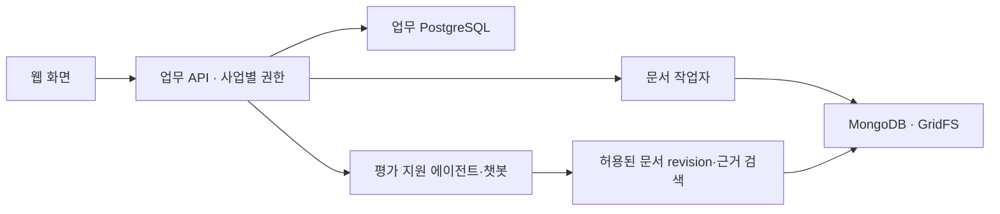

# 문서·DB·평가 지원 챗봇 연계 계약 초안

담당: DaeUng79. 검토: cookiesh1(화면), u-jing(평가·데이터), Lex6won(기획·권한). **현재 API 구현이 아닌 협의용 설계**다. 경로와 스키마는 기반 PR의 `contracts/openapi.json`과 합쳐 확정한다.

## 저장 경계

현재 문서 저장은 MongoDB/GridFS다. 업무 API는 PostgreSQL의 `project_id`와 **접근권한이 있는 문서 연결 레코드**를 관리한다. 원본 해시가 같아 같은 `document_id`가 되더라도 다른 사업에서의 접근권한까지 같아지는 것은 아니다.

파일 원문과 블록을 양쪽 DB에 복제하지 않고 `document_id`·revision·자산 참조로 연결한다. 두 DB를 한 트랜잭션처럼 가정하지 않는다. 재시도 키와 처리 상태를 기록하고, 문서 저장이 검증된 뒤에만 업무 문서의 결과 참조를 공개한다. 실패한 연결은 재시도/대사 작업으로 복구한다.

## 입출력 제안

| 흐름 | 제안 계약 | 담당 |
| --- | --- | --- |
| 등록 | `POST /projects/{project_id}/documents` → `202`, 업무 문서 ID, `job_id`, `status` | DaeUng79; 사업 연결 u-jing 협의 |
| 상태 | `GET /projects/{project_id}/document-jobs/{job_id}` → queued/running/succeeded/failed, 오류 코드·재시도 가능 여부 | DaeUng79 |
| 결과 | 권한 검사 후 문서/요구사항/기준 후보와 원본 revision·근거·warnings·needs_review 반환 | DaeUng79 |
| 기준 확정 | 추출 후보와 별도 저장. 확정자·시각·기준 버전·출처 revision 기록 | u-jing + DaeUng79 |
| 질의응답 | 권한 있는 사업/문서 범위에서 질문 → 답변, 인용 목록, 근거 부족 상태 | DaeUng79; UI cookiesh1 |

재시도 키는 사업·작업 종류·문서 입력·옵션 범위를 포함한다. 작업 실행 성공과 사람의 기준 확정은 별도 상태다. 파싱 작업을 긴 HTTP 요청에 붙이지 않고 worker에서 수행한다. 작업자 중단·타임아웃·재처리 시 상태 갱신과 중복 공개 방지를 검증한다.

## 최소 근거 필드

| 필드 | 의미 |
| --- | --- |
| `project_id`, 업무 문서 ID | 권한과 업무 연결. 원본 해시와 구별 |
| `document_id`, `source_sha256` | 현재 파서 원본 식별자 |
| `source_revision` | 사용한 파싱 결과 버전 |
| `block_id`, 필요 시 셀 ID | 문단/표의 실제 근거 |
| `physical_page_number` | 파일의 물리 페이지; 미확인일 때 null |
| `page_number` | 인쇄 쪽번호; 표지/미확인일 때 null |
| `warnings`, `needs_review` | 페이지/추출 누락과 검토 필요 상태 |

현재 JSON 필드는 보존하고 API 어댑터에서 매핑한다. 페이지를 모르면 임의 번호를 만들지 않는다. 원본/파싱 revision이 바뀌면 과거 추출·답변·확정 기준의 유효성을 다시 확인하며 제출된 평가 기록을 조용히 덮어쓰지 않는다.

## 에이전트·챗봇 완료 조건

- 질문에 답할 때 실제 조회한 문서·revision·블록·페이지 근거를 인용한다. 근거가 없으면 없다고 표시한다.
- 사용자 권한을 검색 전과 원문 열람 시 검사한다. 다른 사업 문서나 DB 전체를 모델에 넘기지 않는다.
- 제안서 안의 지시문은 분석 대상 데이터로 처리한다. 외부 명령 실행·권한 변경·평가 제출의 지시로 사용하지 않는다.
- 점수·확정·서명은 해당 기능의 사람 확인과 서버 권한을 거친다. 챗봇 답변만으로 상태를 바꾸지 않는다.
- 모델은 기본 CI에서 mock을 사용한다. 실제 품질 검증은 합성 질문·정답 근거·인용 정확도·답변 불가 사례를 고정해 별도 기록한다.
- 현재 검색용 청크 생성은 구현되어 있으나 완성된 검색/임베딩/RAG 챗봇을 구현 완료로 표시하지 않는다.

## 먼저 맞출 예제

성공·처리 중·손상 파일·지원하지 않는 PDF/OCR·근거 없음·페이지 미확인·권한 거절·원본 변경·저장 실패·중복 요청 예제를 만든다. 화면 mock과 서버 응답은 같은 스키마 검증을 통과하도록 한다.
