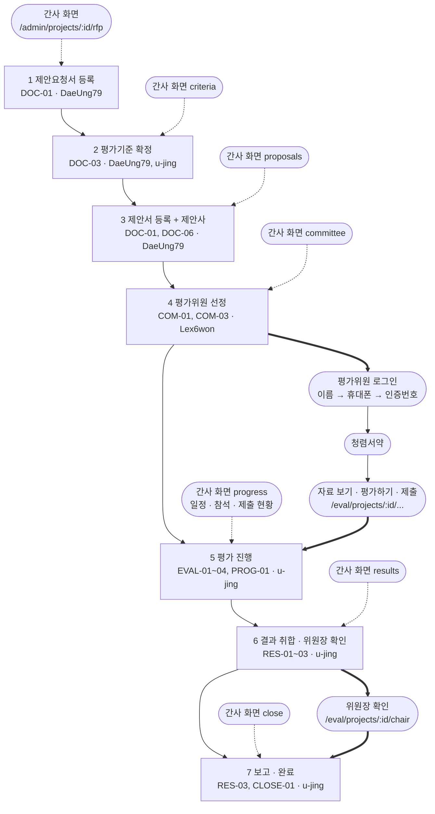
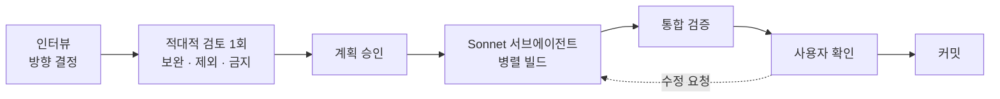

# 심사임당 웹 작업 한눈에 보기 (cookiesh1)

기준 시각: 2026-10-12 · 브랜치 `feat/web-interview-track` · 구현 위치 `apps/web_cookiesh1/`

> **mock 확인 ≠ 인수 통과.** 아래 "완료"는 가짜 서버(mock)에서 화면이 동작했다는 뜻입니다. 팀 인수 기준([ACCEPTANCE](../testing/ACCEPTANCE.md))을 통과했다는 뜻이 아닙니다.

## 1. 한 줄 요약

간사(관리자)와 평가위원이 쓰는 웹 화면을 인터뷰로 방향을 정하고, 가짜 서버(mock)로 먼저 만들어 동작을 확인했습니다. 실제 서버 연결은 아직입니다.

| 배지 | 상태 |
|---|---|
| mock 동작 | 동작함 (관리자 7단계 포함) |
| 실제 API | **미연결** (PR #1 서버를 로컬에서 띄워 보지 않음) |
| 인수 시나리오 | **미실행** |
| 제안 계약 | 전부 "제안" (담당자 합의 전) |

## 2. 업무 워크플로우

팀 공동 흐름 7단계마다 어느 화면에서 하는지, 누가 서버를 맡는지, 어떤 인수 ID로 확인하는지 정리했습니다.

세 역할이 만나는 곳은 굵은 선입니다.

| 만나는 곳 | 내용 |
|---|---|
| 4 → 평가위원 로그인 | 간사가 위원을 뽑으면 위원이 로그인하고 서약합니다 |
| 평가 제출 → 5 | 위원이 낸 점수가 간사 진행 현황에 모입니다 |
| 6 → 위원장 확인 → 7 | 전원 제출 후 위원장이 확인해야 간사가 사업을 완료합니다 |

## 3. 화면 지도

| 경로 | 역할 | 상태 | 인수 ID |
|---|---|---|---|
| `/` , `/login` | 공통 (첫 화면, 로그인) | 완료 | SEC-01 (서버 검증 필요) |
| `/admin` | 간사 (처리할 일, 사업 카드) | 완료 | PROG-01 |
| `/admin/projects` | 간사 (사업 목록) | 완료 | - |
| `/admin/projects/:id/rfp` | 간사 1단계 | 완료 | DOC-01 |
| `…/criteria` | 간사 2단계 | 완료 | DOC-03 |
| `…/proposals` | 간사 3단계 (제안사 포함) | 완료 | DOC-01·06 |
| `…/committee` | 간사 4단계 | 완료 | COM-01·03 |
| `…/progress` | 간사 5단계 (일정·참석 포함) | 완료 | PROG-01 |
| `…/results` | 간사 6단계 | 완료 | RES-01·03 |
| `…/close` | 간사 7단계 | 완료 (신규) | RES-03, CLOSE-01 |
| `/admin/evaluators` | 간사 (위원 후보 풀, CSV 등록) | 완료 (7단계 안으로 일부 이동 예정) | COM-01 |
| `/admin/documents` | 간사 (전체 문서 등록) | **철회** | - |
| `/eval` | 평가위원 (배정 사업) | 완료 | COM-03 |
| `/eval/projects/:id` | 평가위원 (홈) | 완료 | - |
| `…/docs` | 평가위원 (자료 보기, 질의응답) | 완료 | AI-01·02, DOC-02 |
| `…/evaluate` | 평가위원 (평가하기) | 완료 | EVAL-01·02·04 |
| `…/submit` | 평가위원 (제출 점검) | 완료 | EVAL-03 |
| `…/chair` | 위원장 (결과 확인) | 완료 | RES-01·03 |
| 제안서 목차 나란히 보기 | 간사 | 계획 (범위 재결정 필요) | - |

관리자 7단계 경로는 UI_DIRECTION 8절 결정이고, 지금 다른 작업에서 적용 중이라 `App.tsx`에는 아직 옛 경로(`projects/:projectId`, `documents`)가 남아 있습니다.

## 4. 작업 방식

통합 검증 항목: 타입 검사(tsc) · 단위 테스트(vitest) · 빌드 · 실제 빌드에 데모 요소가 없는지 검사 · 브라우저 시나리오(E2E) · 1366×768 스크린샷.

## 5. 진행 타임라인

| 커밋 | 한 일 | 검증 |
|---|---|---|
| `83a11cd` | PR #1 웹 시작 앱을 `apps/web_cookiesh1`로 옮기고 mock 모드 추가 | 타입·빌드 통과, mock 흐름 스크립트 통과 |
| `6049d52` | 인터뷰 트랙 6단계 화면, 공통 UI, 임시보관, 제안 계약 mock, 문서(UI_DIRECTION) | vitest 16개, 브라우저 시나리오 21개 통과, 콘솔 오류 0 |
| `fe9757e` | 디자인 시안 반영, 근거 서랍, 제출 점검, 서약 시트, 목차 샘플 계획 문서 | vitest 16개, E2E 23개 통과, 콘솔 오류 0 |
| `90e0119` | 첫 화면, Toss식 로그인, 평가위원 왼쪽 칸, 관리자 문서 등록 진입점 | vitest 16개, E2E 24개 통과, 실제 빌드에 데모 요소 없음 |
| 미커밋 | 관리자 7단계 재구성, 제안사·일정·완료 계약 추가, 문서 등록 화면 철회, 탭을 단계 화면으로 교체 | vitest 21개, E2E 28개 통과, 콘솔 오류 0 |

## 6. 제안 계약 현황

`apps/web_cookiesh1/src/api/contract.ts` 기준. 전부 **제안** 상태이며 실제 서버에 없습니다.

| 경로 | 합의 대상 | 상태 |
|---|---|---|
| `auth/login`, `auth/evaluator/otp`, `auth/evaluator/verify` | u-jing | 제안 |
| `GET /me/assignments` | Lex6won | 제안 |
| `GET·POST /projects/{id}/pledge/me` | Lex6won | 제안 |
| `…/documents` (업로드·상태·원문 블록) | DaeUng79 | 제안 |
| `…/criteria`, `criteria/confirm` | DaeUng79, u-jing | 제안 |
| `…/matches`, `…/ask` | DaeUng79 | 제안 |
| `committee/draw`의 `exclusions`, `committee/exclusions`, `committee/chair` | Lex6won | 제안 |
| `…/progress` | u-jing, Lex6won | 제안 |
| `…/results/detail`, `results/confirm` | u-jing | 제안 |
| `…/vendors` (제안사 등록, A·B·C 코드) | DaeUng79, u-jing | 제안 (신규) |
| `…/schedule` (일정·발표 순서·참석) | Lex6won, u-jing | 제안 (신규) |
| `…/close` (사업 완료) | u-jing | 제안 (신규) |

## 7. 남은 일 / 결정 대기 / 팀과 맞출 것

| 남은 일 (내가 할 일) | 결정 대기 (사용자) | 팀과 맞출 것 |
|---|---|---|
| 관리자 7단계 재구성 마무리와 검증 | 푸시·PR을 언제 할지 | 제안 계약 12묶음 합의 (6절) |
| 실제 API 연결 테스트 (PR #1 서버를 로컬에서 실행) | 목차 계약 확장 (보류) | 팀원이 확보 중인 데이터 4개 도착 시 반영 |
| 팀원 확보 데이터 4개 반영 (도착 대기) | 샘플 데이터 생성기 (보류) | 정책 4가지: 5등급 점수, 위원장 권한, 본인확인 방식, 개인정보 문구 |
| README에 포크·실행 안내 추가 (UI 안정화 후) | E2E 스크립트를 저장소로 옮길지 (선택) | 이슈 #2: 제척 기준, 분야별 추첨 정원 |
| 인수 시나리오 실행과 결과 기록 | A/B 트랙 비교 (AI 자율 트랙과 같은 범위로 비교) | 동료 리뷰 |

---

기준 시각: 2026-10-12. 이 문서는 개발 진행 정리이며, **mock에서 동작을 봤다고 인수 기준을 통과한 것이 아닙니다.** 실제 서버 연결과 ACCEPTANCE 시나리오 실행 뒤에 통과 여부를 따로 기록합니다.
